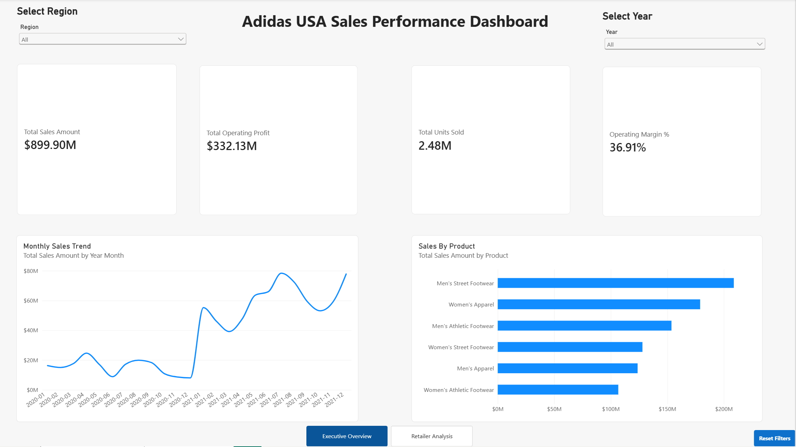
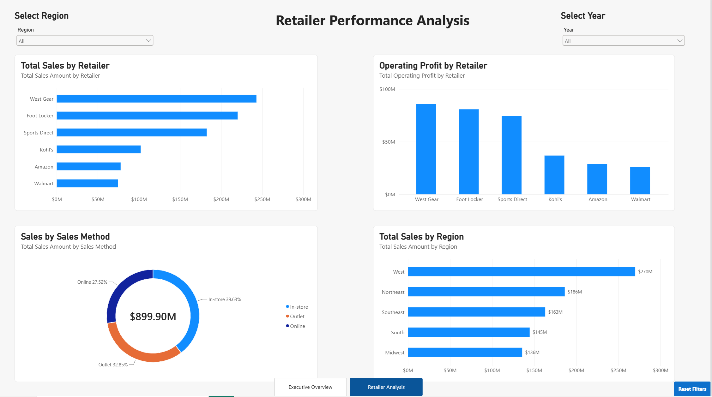
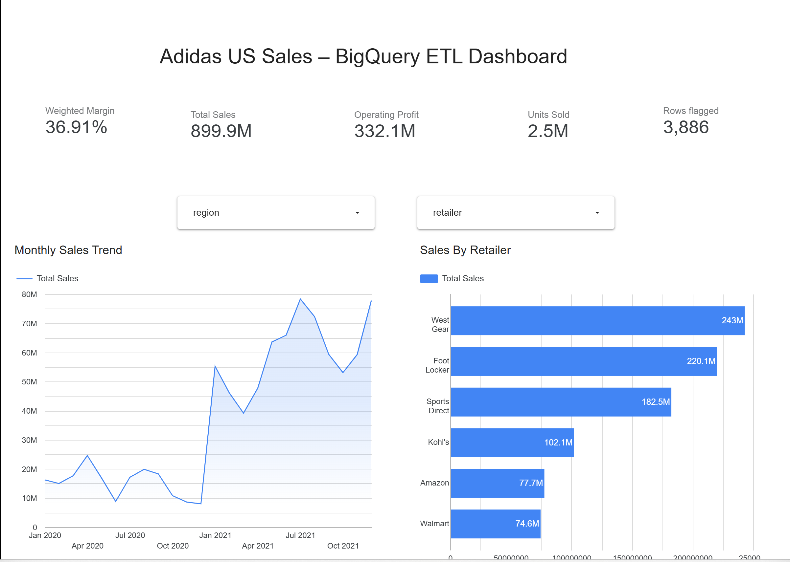

# Adidas USA Sales Performance Analysis

## Project Status

Completed

## Project Overview

This portfolio project uses a publicly available Adidas USA sales sample dataset to analyze sales, operating profit, product performance, retailer performance, regional trends, and sales channels during 2020 and 2021.

The project demonstrates data cleaning, data-quality validation, SQL analysis, dimensional modeling, Power BI dashboard development, DAX measures, a cloud ETL pipeline in Google BigQuery, and business recommendations.

## Business Objectives

- Evaluate total sales, units sold, operating profit, and operating margin.
- Identify high-performing and underperforming products.
- Compare retailer performance.
- Analyze sales and profitability across regions, states, and cities.
- Compare in-store, online, and outlet sales methods.
- Identify monthly and yearly performance trends.
- Detect data-quality issues and reconcile financial calculations.
- Recommend actions to improve sales and operating performance.

## Tools and Technologies

- **Power BI:** Dashboard development, data modeling, interactive slicers, bookmarks, and navigation
- **Power Query:** Data cleaning, transformation, validation, and preparation
- **DAX:** KPI measures, operating margin calculations, and date analysis
- **SQL:** Business analysis queries and data aggregation
- **Microsoft Excel:** Source data review and cleaned dataset storage
- **Google BigQuery:** Cloud data warehouse for the raw, fact, and monthly summary tables
- **BigQuery SQL:** ETL scripts using CTEs, window functions (LAG), data validation checks, and source-to-target reconciliation
- **Data Studio (Looker Studio):** Cloud dashboard with KPI scorecards, monthly trend, retailer ranking, data-quality flag, and interactive filters
- **Git and GitHub:** Version control, project documentation, and portfolio presentation

## Data Model

- `fact_sales`
- `dim_date`
- `dim_product`
- `dim_retailer`
- `dim_location`

## Project Structure

```text
data/
  raw/                  original Adidas sales file
  processed/            cleaned dataset
sql/
  analysis_queries.sql  business analysis queries
  01-04_*.sql           BigQuery ETL pipeline scripts
powerbi/                Power BI report (.pbix)
docs/                   data cleaning and DAX documentation
images/                 dashboard screenshots
```

## Dashboard Preview

### Executive Overview



### Retailer Analysis



## Project Documentation

- [Data Cleaning and Transformation](docs/data_cleaning.md)
- [DAX Measures and Date Table](docs/dax_measures.md)
- [SQL Analysis Queries](sql/analysis_queries.sql)

## Key Insights

- Total sales reached **$899.90M**, generating **$332.13M** in operating profit.
- The overall operating margin was **36.91%**, with **2.48M units sold**.
- **West Gear** was the highest-performing retailer, contributing approximately **$243M** in sales.
- The **West** was the strongest region, generating approximately **$270M** in sales.
- **Men's Street Footwear** was the leading product category, with approximately **$209M** in sales.
- **In-store sales** represented the largest sales method at **39.63%**, followed by Outlet at **32.85%** and Online at **27.52%**.
- Sales performance increased significantly in **2021** compared with 2020.

## BigQuery ETL Pipeline & Data Studio Dashboard

This extension rebuilds the Adidas analysis as a cloud data pipeline on Google BigQuery, with a Data Studio (formerly Looker Studio) dashboard on top.

### Business Questions

1. What are total sales, operating profit, and margin across the business?
2. How did monthly sales trend from 2020 to 2021?
3. Which retailers drive the most revenue?
4. How reliable is the data, and which records need review?

### Pipeline

```text
us_sales (raw upload, 9,648 rows)
 ├─ 01_validate_raw.sql          row counts, duplicates, nulls, zero sales, sales ≠ price × units
 ├─ 02_build_sales_fact.sql      cleaned fact table: trimmed text, gender/category, safe margin,
 │                               data-quality flag, load timestamp
 │   └─ 03_build_monthly_summary.sql   monthly retailer summary (CTE + LAG for MoM growth)
 └─ 04_reconcile.sql             source-to-target check across all three tables
```

Scripts:
[01_validate_raw.sql](sql/01_validate_raw.sql) ·
[02_build_sales_fact.sql](sql/02_build_sales_fact.sql) ·
[03_build_monthly_summary.sql](sql/03_build_monthly_summary.sql) ·
[04_reconcile.sql](sql/04_reconcile.sql)

### Design Decisions

- **Raw table kept untouched**, so the fact table can be rebuilt at any time (`CREATE OR REPLACE` makes every script re-runnable).
- **Flag, don't delete:** 3,886 rows where reported sales ≠ price × units are flagged with `is_sales_mismatch` and shown in the dashboard instead of being dropped.
- **Weighted margin:** calculated as SUM(profit) / SUM(sales), not an average of row-level margins, which would over-weight small orders.
- **Summary table for trends:** the monthly chart reads 144 pre-aggregated rows instead of scanning the full fact table.

### Validation Results

| Check | Result |
|---|---|
| Rows (raw = fact) | 9,648 = 9,648 |
| Duplicate IDs / null keys | 0 / 0 |
| Total sales (raw = fact = summary) | $899,902,125 |
| Rows flagged for sales mismatch | 3,886 |

### Dashboard



### Key Insights

- Sales stayed around $10–25M a month in 2020, then rose sharply in 2021 to a peak near $78M.
- West Gear ($243M) and Foot Locker ($220M) generate about half of all sales; Walmart and Amazon trail at under $80M each.
- About 40% of rows (3,886) have reported sales that differ from price × units, so totals should be read with that caveat.
